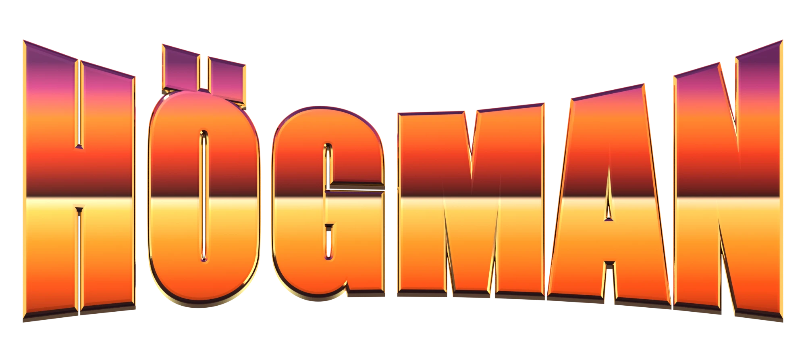

<p align="center">
  <a href="https://hogman.network"></a>
</p>

<p align="center"><strong>A PRIVATE INTERNET · BY INVITATION · NO MERCY</strong></p>

<p align="center">
  <a href="LICENSE"></a>
  
  <a href="https://hogman.network"></a>
</p>

<p align="center">
  
</p>

# Your pen. Your rules. Clean pigs only.

**Get a pen:** [get.hogman.network](https://get.hogman.network). Free while we test it; sign-ups
are by invitation for now. Hogman runs pen control planes on `hogman.network` (hosted-only,
D-24), with the full [AGPL-3.0](LICENSE) codebase open to inspect, audit, and verify.

Invited to someone's pen? You don't install anything up front: open the invite link and
copy the one command its page gives you.

Hogman gives you your own **private internet** for the people you choose: hosted on our server
in about a minute, while your sites and folders are served straight from your own computers. You
hold the gate. Your swine get real names, real websites, and standard browser HTTPS. The filthy
horde stays outside the fence, howling.

## In plain words

**Your own little internet, with a guest list.** You make a private network and invite the
people you want. Inside it you can have websites, message boards, photo pages, anything you'd
normally use in a browser, and they work just like the sites you already visit. The
difference: only the people you let in can reach them.

**From the outside, there is nothing there.** Your sites don't have public addresses, so
strangers, scrapers and attackers can't find them, can't load them and can't try to break in.
There's no login page for them to guess at.

**You stay in charge.** You hand out invitations, everyone gets a proper name, and if someone
misbehaves you remove them, every device at once, in about two seconds.

**What people use it for.** You bring the apps (a photo gallery, a forum, a wiki: there are
good free ones), put them in your pen with one command, and Hogman makes them private.

- **A family:** photo albums, a shared calendar, recipes, the family chat, seen by nobody else.
- **Friends, clubs and teams:** your own private Facebook, with a message board, events and a
  members page.
- **A business and its customers:** a customer portal only invited customers can even reach,
  so attackers never see a login page. (Hogman isn't audited yet; wait for that before
  putting anything high-stakes behind it.)
- **A small company:** internal tools and a wiki, reachable by employees from anywhere and
  invisible to everyone else.
- **A community:** a forum or archive away from bots, trolls and drive-by strangers.
- **Your own projects:** the home server or side project, reachable from your laptop anywhere,
  with real HTTPS.

**Questions people ask.**

- *Do I need to be technical?* To get a pen and invite people, no: you sign up on a web page,
  and your guests click a link and paste one command. Putting a folder or a website in the
  pen is one command too (`hogman-join share photos ~/holiday`). Bigger apps (a forum, a
  photo gallery) you install on an always-on computer, then share the same way.
- *Do my people install anything?* A small program, once; the invite link walks them through
  it on a Mac or Linux (Windows and a phone app are coming).
- *Can strangers find my pen?* No. Nothing in it has a public address (`ns1.hogman.network`
  answers only temporary ACME challenge records, never IP addresses).
- *Is it a VPN?* No. A VPN hides your browsing; a pen is a private place with its own sites
  and its own guest list, and your normal internet keeps working.
- *Why not just use Tailscale?* If you're technical and only want your own devices
  connected, do: Hogman is built on Tailscale's open-source pieces and runs alongside it.
  Hogman is for running a private place for a group of people: guests join from a link, the
  keeper runs the guest list from a web page, and every pen gets its own names and real HTTPS
  without exposing any site IPs (pen and site hostnames appear in public Certificate
  Transparency logs, never what's on the sites).
- *Can you see what we do?* Traffic between members is encrypted end to end. Because we host
  your pen's control plane, we can see who is in it and which pen names are looked up, not
  what anyone says or sends (see [The honest bit](#the-honest-bit)).

## How it works

Full guides, use cases and security architecture: **[hogman.network/docs](https://hogman.network/docs/)**.

**A private corner of the internet for you and your people.**

1. **Make a pen.** Sign up, and about a minute later you have your pen: your own walled-off
   space on the internet. You make the rules.
2. **Invite your people.** Send each person a link. They open it, copy the one command it shows,
   and they're in. Nobody else gets in without a link from you.
3. **Private inside, invisible outside.** Inside: your photos, your chat, your own websites,
   in any ordinary browser. Outside: strangers and bots find nothing at all.

A normal website is open to the whole internet, and bots try its login page all day. A site
in your pen can't be found from the open internet: to everyone you didn't invite, it
doesn't exist.

**Putting something in.** Once you're in, one command puts a folder or a website you're
building into the pen, with its own name and standard HTTPS:

```text
$ ./hogman-join share photos ~/holiday --note "Summer trip photos"
$ ./hogman-join share blog 3000               # a site you're building, by its port

✓ https://blog.smith.pens.hogman.network is up.
  Everyone in the pen can open it.
```

Each share is a small server device of its own (`tag:server`), so your laptop itself still takes no
visitors, and nothing needs administrator rights or an open port. Everything shared or named
shows up in the **Sites in this pen** list on your home page (with who runs it and its
optional `--note`). Add `--background` to run in the background and start automatically at login
(Mac and Linux systemd; use `--no-service` to run only until restart);
`./hogman-join share stop blog` takes it down and frees the name. A computer that isn't in
the pen can share too: press *Get a share link* on your home page and add the link it gives you
to the end of the command.

**Keeping up to date.** Run `./hogman-join update` on a joined computer (or pass
`'https://<host>'` or `--pen ZONE` if you're on more than one pen). It downloads the matching
binary from `/join/dl/`, checks its SHA-256 digest against `SHA256SUMS` from the same server over
the same HTTPS connection (catching corrupted or truncated downloads, with the same server trust as
the initial download), replaces `hogman-join`, restarts the pen's agent if running, updates
cached `share` binaries on disk (restarting service-managed background shares automatically while
foreground shares keep serving until restarted), and removes any leftover legacy Hogman root
certificates from older releases.

## Under the hood

- **The network:** each pen is a private [WireGuard](https://www.wireguard.com) mesh with its own
  [Headscale](https://github.com/juanfont/headscale) control plane. Devices join via embedded
  userspace `tsnet`. Traffic is end-to-end encrypted, device to device, through the pen's own
  relay (built into its control server) only when a firewall blocks a direct path. Relaying, it
  carries only encrypted WireGuard packets and never sees what anyone sends.
- **Names:** a pen zone such as `smith.pens.hogman.network`, answered with mesh IPs only inside the
  pen (pen names are used once and never recycled, D-21). Public DNS (`ns1.hogman.network`) serves
  only temporary `_acme-challenge.*` TXT records, `SOA`, `NS`, and `CAA` — zero public
  `A`/`AAAA` records exist under `pens.hogman.network`.
- **Padlocks (certificates):** standard public HTTPS certificates issued via split-horizon ACME
  DNS-01 (Let's Encrypt primary with Google Trust Services EAB fallback via embedded
  [CertMagic](https://github.com/caddyserver/certmagic)). Your browser verifies certificates with its
  normal operating system trust store — no custom root CA is ever installed (`D-18`, `D-22`).
  Private keys stay on the sharer's computer (or the portal). Trade-offs to note: pen and site
  names appear in public Certificate Transparency logs (never site contents, `D-21`), and hosted
  pens share `pens.hogman.network` until PSL listing, so use a separate browser profile for any
  pen you don't fully trust (`D-19`). Pens made before the public-certificates switch-over must
  be recreated (`fp=` invite links are refused).
- **Access:** default deny. Hogman's registrar keeps the member list and writes the access
  policy. A *personal* device is a member's laptop or desktop; a *server* is a share node.
  Members' devices can reach servers (on `:443` only) and the pen's services; personal devices
  accept no incoming connections; a device that joins without an invite gets nothing. A pen carries
  HTTPS and nothing else: no ssh, no other ports (decision D-11: the best fix for a surface is
  to delete it). `hogman-join`'s loopback proxy pins every dialed IP to a verified mesh peer via
  `WhoIs`, never touching `127.0.0.1` or LAN hosts.
- **Invites:** a single-use token in `https://smith.gate.hogman.network/join#t=...` (covered by the
  shared wildcard `*.gate.hogman.network` certificate). `hogman-join` runs unprivileged as you
  (never as administrator), with a local PAC-scoped proxy that carries only HTTPS to the pen's names.
- **The boot:** deletes all of a member's devices, revokes their keys and invites, rewrites the
  policy, and retires their site names permanently. About two seconds.
- **Hosted pens:** four containers per pen (Headscale, registrar, Caddy for `home.<zone>`, and
  the pen's own `core-mesh` Tailscale node), running non-root (`uid 65532`) on an isolated Docker
  bridge with its own folder and about 75 MB of memory. Only each pen's front-door route and relay
  port are exposed to the internet.

What happens when Bob opens `https://photos.smith.pens.hogman.network`:

```text
1 DNS     photos.smith.pens.hogman.network → 100.80.12.7   (the pen's DNS, on the mesh only)
2 policy  bob's laptop → alice's photos server: allowed (member → server, :443 only)
3 tunnel  WireGuard, bob → alice, end to end (direct, else the pen's relay ciphertext)
4 TLS     standard CertMagic cert presented by alice's share; verified by Bob's stock OS trust store
✓ page loads, with the padlock

A stranger typing the same address: NODATA from ns1. Zero A/AAAA records exist publicly.
```

## What you get

- **Proper names.** Every pen has its own name, and so does everything in it:
  `alice.yourpen.pens.hogman.network`, `blog.alice.yourpen.pens.hogman.network`. Nobody outside
  can look up an address for them.
- **The padlock, without the paperwork.** Standard web HTTPS works out of the box in stock
  browsers with no root certificates to install.
- **Invitation only.** Single-use invite links. How someone earns one is up to you.
- **The boot.** One press and a member is back outside the fence, every device at once.
- **Walled off from everyone else.** Every pen has its own isolated control plane, names, and
  relay port. Traffic between members is encrypted end to end.

## Meet the farm

<table>
  <tr>
    <td width="25%" valign="top"><br><strong>THE TOP HOG</strong><br><em>That's you.</em><br>The keeper. You run the pen and decide who gets in, what they're called, and who gets the boot.</td>
    <td width="25%" valign="top"><br><strong>THE FENCE</strong><br><em>The network.</em><br>An encrypted mesh that exists only for those inside it. From outside there is nothing to see and no way in but the gate.</td>
    <td width="25%" valign="top"><br><strong>THE CLEAN PIGS</strong><br><em>Your people and their devices.</em><br>Everyone you invited, each known by name. They browse, host sites and visit each other.</td>
    <td width="25%" valign="top"><br><strong>THE HORDE</strong><br><em>Everything else.</em><br>Strangers, scrapers, bots. They can scream at the fence all night. Nothing inside can hear them.</td>
  </tr>
</table>

## Getting in, if you're on the list

1. **You get a link.** It carries your single-use invitation to your pen's gate (`smith.gate.hogman.network`).
2. **You run one command.** The link's page gives it to you. It checks the network over
   normal HTTPS, asks what you'd like to be called, and starts a small local connection as you —
   no custom root certificate. On a Mac it may ask for your password once, only to point your
   browsers at the pen.
3. **You're in.** Open your ordinary browser and go.

```text
# the command your invite page gives you: copy, paste, enter
$ curl -fsSLo hogman-join https://smith.gate.hogman.network/join/dl/hogman-join-Darwin-arm64 \
    && chmod +x hogman-join \
    && ./hogman-join 'https://smith.gate.hogman.network/join#t=(your invite)'

• Checking the network at smith.gate.hogman.network
  network: smith.pens.hogman.network

• Redeeming the invite
  Choose your name on the network: alice
  welcome, alice

✓ You're in. You are alice on smith.pens.hogman.network.
```

**No Tailscale needed, and it won't fight yours.** The join tool runs its own small
connection, as you, never as administrator. It carries only HTTPS to the pen's names, and
leaves everything else on your computer, including any Tailscale of your own, alone.

**More devices:** your pen's home page has *Add a device*: a one-time link and QR code. The
new device joins as you, under your name.

## The boot

<p align="center">
  
</p>

Sometimes a clean pig goes bad. One command and they're outside the fence, with their sites
gone and their names held so nobody can pretend to be them.

| Suspend | Let back in | The boot |
|:---:|:---:|:---:|
| **2.0 s** | **0.8 s** | **2.1 s** |

*Measured on a real Mac over an ordinary home network, from pressing enter to the door closing.*

## Get a pen

1. **Sign up** at [get.hogman.network](https://get.hogman.network): name your pen and
   yourself. About a minute later it's up on our server, with its own isolated gate and zone.
   While we test, you need a sign-up code from someone already in;
   no code, or the farm is full? Join the waiting list on the same page.
2. **Get your laptop in.** Open the link you're given on your laptop and copy one command.
3. **Let your people in.** Your pen's home page makes invite links and QR codes, and shows
   the herd: suspend anyone, or give them the boot. No server, no shell.

## Open source

Hogman runs pen control planes only on `hogman.network` (`D-24`, no self-hosted pen server
support), while your sites and folders run on your own computers via `hogman-join share`. All
code is open source under [AGPL-3.0](LICENSE) so anyone can audit it and verify every release binary
against GitHub's SLSA build provenance:

```bash
gh attestation verify hogman-join --repo celtiberi/hogman
```

- [The operator guide](deploy/README.md) documents how the hosted server, `challenge-dns`, backups,
  monitoring, and sign-ups run.
- [`core/README.md`](core/README.md) documents the core stack and Docker test harness.
- [`DESIGN.md`](DESIGN.md) covers the initial design background and superseded architecture notes.

## The honest bit

- **A pen is private, not anonymous.** The keeper (and us as host) can see who is in the pen,
  their devices, and which pen names get looked up. Site names appear in public CT logs.
- **What neither can see:** what members say or send to each other (WireGuard + TLS 1.3), or
  their ordinary browsing outside the pen.
- **Choose your Top Hog.** Joining a pen means trusting the person who runs it.

## Status

**Experimental.** Young security software, not independently audited, running its public hosted
service. Try it, break it, tell us what you find. Don't trust it with anything that matters yet.

| On tour now | Not on the bill yet |
|---|---|
| Hosted pens: control plane, names, public DNS-01 certs, invites, the boot | Phones (the app is in the works) |
| Joining from Linux and a Mac: HTTPS only, never as administrator, alongside your own Tailscale | Windows (built, never tried) |
| Isolated pens on a shared host behind `*.gate.hogman.network` | Open sign-ups for everyone |
| Verifiable GitHub-built releases (`gh attestation verify`) | Independent security audit |
| Nightly encrypted backups, pulled to a separate machine; restore tested | PSL listing for `pens.hogman.network` |
| Alerts when the server, certs, or backups fail | |
| Pens on our server: sign up by invitation while we test, or join the waiting list | |
| Run your pen from its home page: invites, the herd, the boot | |
| Put a folder or a website in your pen with one command (`hogman-join share`) | |
| Automated Docker e2e suites covering pens, ACME DNS-01, and shared hosts | |

**Found a security problem?** Please don't open a public issue. Report it privately
with GitHub's **Security → Report a vulnerability** button on this repository.

## How it's built

Forged from good open-source steel: [Headscale](https://github.com/juanfont/headscale), the
[Tailscale](https://tailscale.com) `tsnet` stack, [Caddy](https://caddyserver.com), and
[CertMagic](https://github.com/caddyserver/certmagic), plus four pieces of our own:

| Piece | What it does |
|---|---|
| [`core/registrar`](core/registrar) | The ledger: members, invites, devices, names, the boot. Writes access rules, serves mesh DNS, and manages ACME DNS-01 challenges. |
| [`core/join`](core/join) | `hogman-join`: verifies, enrols, joins side by side, proxies `:443` only, and shares sites with CertMagic TLS. |
| [`deploy/challenge-dns`](deploy/challenge-dns) | Authoritative DNS-01 challenge server (`_acme-challenge.*` TXT, SOA, NS, CAA; never A/AAAA). |
| [`deploy/hogman-host`](deploy/hogman-host) | Runs isolated hosted pens behind a shared front door, backups, and sign-ups. |

## License

Hogman's code is free software under the [GNU Affero General Public License v3.0](LICENSE).
You may use, study, change and share it. If you run a changed version as a service for
others, you must offer them your changes under the same license.

The artwork (the paintings, the logo, and the crops of them in `docs/img/`) is not covered by
that license. All rights reserved.

<p align="center"><strong>Keep a clean pen.</strong></p>
