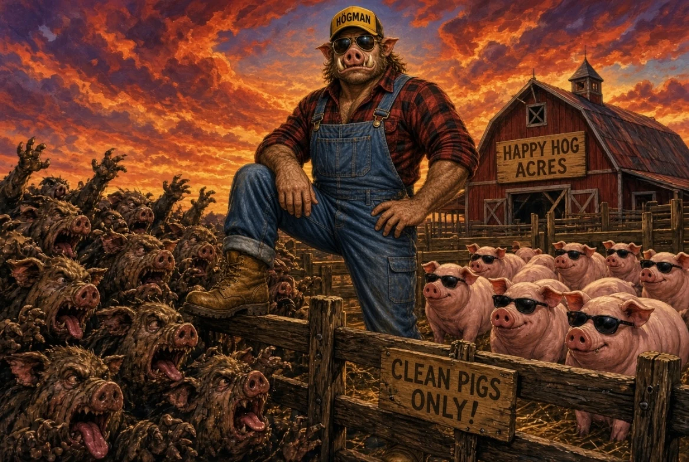
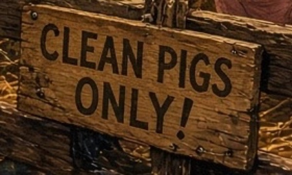
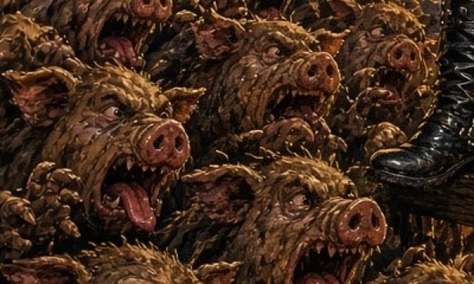
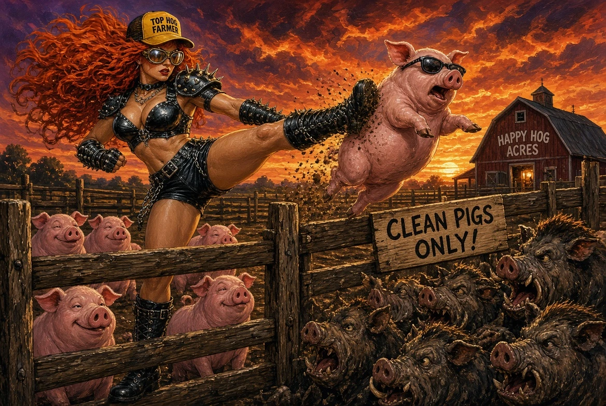

<p align="center">
  <a href="https://hogman.network"></a>
</p>

<p align="center"><strong>A PRIVATE INTERNET · BY INVITATION · NO MERCY</strong></p>

<p align="center">
  <a href="LICENSE"></a>
  
  <a href="https://hogman.network"></a>
</p>

<p align="center">
  
</p>

# Your pen. Your rules. Clean pigs only.

**Get Hogman:**

```bash
curl -fsSL https://hogman.network/install.sh | sudo bash     # on a fresh Ubuntu 24.04 server
```

Invited to someone's pen? You don't install anything up front: open the invite link and
copy the one command its page gives you.


Hogman lets you run your own **private internet** for the people you choose. You hold the
gate. Your swine get real names, real websites and real padlocks. The filthy horde stays
outside the fence, howling.

- **Proper names.** Every pen has its own name, and so does everything in it:
  `alice.yourpen.hogman`, `blog.alice.yourpen.hogman`. Nobody outside can look them up.
- **The padlock, without the paperwork.** Each pen runs its own certificate authority, so
  sites get HTTPS automatically. That authority can only vouch for names inside the pen.
- **Invitation only.** Single-use invite links. How someone earns one is up to you.
- **The boot.** One command and a member is back outside the fence, every device at once.
- **Nobody upstream.** One small server you control. Traffic between members is encrypted
  end to end; the keeper never sees it.

## Meet the farm

<table>
  <tr>
    <td width="25%" valign="top"><br><strong>THE TOP HOG</strong><br><em>That's you.</em><br>The keeper. You run the pen and decide who gets in, what they're called, and who gets the boot.</td>
    <td width="25%" valign="top"><br><strong>THE FENCE</strong><br><em>The network.</em><br>An encrypted mesh that exists only for those inside it. From outside there is nothing to see and no way in but the gate.</td>
    <td width="25%" valign="top"><br><strong>THE CLEAN PIGS</strong><br><em>Your people and their devices.</em><br>Everyone you invited, each known by name. They browse, host sites and visit each other.</td>
    <td width="25%" valign="top"><br><strong>THE HORDE</strong><br><em>Everything else.</em><br>Strangers, scrapers, bots. They can scream at the fence all night. Nothing inside can hear them.</td>
  </tr>
</table>

## Getting in, if you're on the list

1. **You get a link.** It carries your invitation and the fingerprint of the pen's
   certificate, so you know you're at the right gate.
2. **You run one command.** The link's page gives it to you. It checks the fingerprint,
   asks what you'd like to be called, and adds the pen's certificate to your computer.
3. **You're in.** Open your ordinary browser and go.

```text
$ ./hogman-join 'https://hs.example.com/join#t=…'

• Checking the network at hs.example.com
  network: bobo.hogman
  its certificate matches the link
  and can only vouch for names ending in .bobo.hogman

• Redeeming the invite
  welcome, alice

✓ You're in. You are alice on bobo.hogman.
```

**No Tailscale needed, and it won't fight yours.** If you already use Tailscale for
something else, the join tool notices and joins **side by side**: its own small connection
carries only the pen's names, and your other network keeps running.

**More devices:** your pen's home page has *Add a device*: a one-time link and QR code. The
new device joins as you, under your name.

## The boot

<p align="center">
  
</p>

Sometimes a clean pig goes bad. One command and they're outside the fence, with their sites
gone and their names held so nobody can pretend to be them.

| Suspend | Let back in | The boot |
|:---:|:---:|:---:|
| **2.0 s** | **0.8 s** | **2.1 s** |

*Measured on a real Mac over an ordinary home network, from pressing enter to the door closing.*

## Raise your own pen

You need a small Ubuntu 24.04 server (2 GB is plenty; about $12 a month) and a hostname
pointing at it, such as `hs.example.com`.

```bash
# 1. Install. Sets the server up (updates, Docker, firewall), installs Hogman, starts the front door.
curl -fsSL https://hogman.network/install.sh | sudo bash

# 2. Raise a pen and make yourself its keeper.
hogman-host add mypen hs.example.com
hogman-host pen mypen member add you --role owner

# 3. Let the clean ones in, and show the filthy ones out.
hogman-host pen mypen invite create --note "alice, clean pig"
hogman-host pen mypen member kick gary "rolled in something"
```

The installer prints what's next: managing the server over your own Tailscale network with
SSH closed to the internet, and moving the pen's root key somewhere safe. Run the same
`curl` again later to update, then `hogman-host upgrade mypen`.

One server can hold many pens: `hogman-host add` again with another name and hostname. Each
pen is walled off from the others, in its own folder you can move to another server. More in
[deploy/README.md](deploy/README.md). To run a single pen by hand instead, see
[core/README.md](core/README.md).

How and why it's built this way: [DESIGN.md](DESIGN.md).

## Don't want a server? We'll keep your pen

Hosted pens are coming: we run the server, you run the pen. Same software, so you can take
your pen's folder and leave whenever you like. Hosting your pen means we can see who's in it
(not what anyone says), and could in principle add a device to it, the same catch as
Tailscale. If that's too much trust, raise your own.

## The honest bit

- **A pen is private, not anonymous.** The keeper knows who is in the pen, their devices,
  and which pen names get looked up.
- **What the keeper can't see:** what members say to each other, or their ordinary browsing
  outside the pen.
- **Choose your Top Hog.** Joining a pen means trusting the person who runs it.

## Status

**Experimental.** Young security software, not audited, with one public pen so far.
Try it, break it, tell us what you find. Don't trust it with anything that matters yet.

| On tour now | Not on the bill yet |
|---|---|
| The pen: server, names, certificates, invites, the boot | Phones (the app is in the works) |
| Joining from Linux and a Mac, side by side with Tailscale | Windows (built, never tried) |
| Many pens on one server, kept apart | Hosted pens (first server going up) |
| A one-line installer for servers; updates in under a minute | A security audit |
| A real pen live on the internet: `farm.hogman`, joined from a Mac | |
| Nightly encrypted backups, pulled to a machine you own; restore tested | |
| Alerts on your phone when the server or its backups stop | |
| End-to-end tests: 105 checks for a pen, 32 for a shared host | |

**Found a security problem?** Please don't open a public issue. Report it privately
with GitHub's **Security → Report a vulnerability** button on this repository.

## How it's built

Forged from good open-source steel: [Headscale](https://github.com/juanfont/headscale), the
[Tailscale](https://tailscale.com) client, [CoreDNS](https://coredns.io),
[step-ca](https://smallstep.com/certificates/) and [Caddy](https://caddyserver.com), plus
three pieces of our own:

| Piece | What it does |
|---|---|
| [`core/registrar`](core/registrar) | The ledger: members, invites, devices, names, the boot. Writes the pen's access rules and DNS. |
| [`core/join`](core/join) | `hogman-join`: verifies, trusts, enrols and joins, on macOS, Linux and Windows. |
| [`deploy/hogman-host`](deploy/hogman-host) | Runs many pens on one server behind a shared front door. |

## License

Hogman's code is free software under the [GNU Affero General Public License v3.0](LICENSE).
You may use, study, change and share it. If you run a changed version as a service for
others, you must offer them your changes under the same license.

The artwork (the paintings, the logo, and the crops of them in `docs/img/`) is not covered by
that license. All rights reserved.

<p align="center"><strong>Keep a clean pen.</strong></p>
