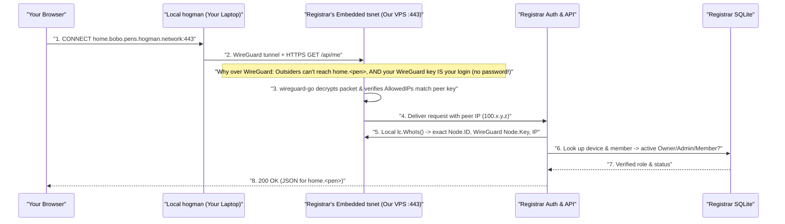
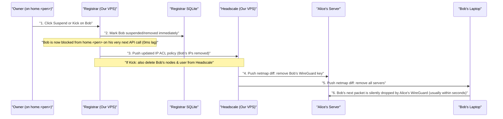

# How Hogman Works: Every Step and Why It Happens

A plain-English reference map of every moving part in a Hogman pen, what talks to what, and *why* each step exists.

---

## Quick Glossary (Every Abbreviation Spelled Out)

- **PAC (Proxy Auto-Configuration):** A tiny JavaScript rule file that tells your browser *which* websites should go through a local proxy (`*.<pen>.pens.hogman.network`) and which should go straight to the regular internet (`google.com`).
- **VPS (Virtual Private Server):** Our cloud server that hosts Headscale and Registrar.
- **IP (Internet Protocol) address:** The numeric address of a computer on a network (like `100.88.12.5`).
- **ISP (Internet Service Provider):** Your home/mobile internet company (Comcast, AT&T, Verizon, etc.), which assigns your router's public real-world IP address.
- **DNS (Domain Name System):** The phonebook that translates a human-readable domain name (`photos.bobo.pens.hogman.network`) into an IP address (`100.88.12.5`).
- **NAT (Network Address Translation):** What home and office Wi-Fi routers do to let many devices share one public ISP IP address (which normally blocks outsiders from connecting directly inward).
- **ACL (Access Control List):** Firewall rules specifying exactly which devices are allowed to talk to which other devices and ports.
- **UDP (User Datagram Protocol):** Lightweight internet packet protocol used by WireGuard tunnels and DNS queries (works well for punching through home routers).
- **TCP (Transmission Control Protocol):** Reliable connection protocol used underneath web browsing (`HTTPS`).
- **TLS (Transport Layer Security):** The encryption and certificate-verification layer that turns `HTTP` into `HTTPS` (the browser lock icon).
- **HTTPS (Hypertext Transfer Protocol Secure):** Standard encrypted web traffic (`HTTP` running over `TLS`).
- **ACME (Automatic Certificate Management Environment):** The automated protocol used by Let's Encrypt / Google Trust Services to prove a server owns a domain name and issue it a trusted HTTPS certificate.
- **VPN (Virtual Private Network):** Software that routes traffic over an encrypted private tunnel.
- **`tsnet` (Tailscale embedded networking library):** Tailscale's Go library embedded inside `hogman` and `registrar` so they can join a WireGuard mesh directly inside the app without installing a system-wide VPN driver.
- **SQLite:** Lightweight file-based database embedded directly inside `registrar` and `headscale`.
- **REST API (Representational State Transfer Application Programming Interface) / JSON (JavaScript Object Notation):** Standard HTTP web endpoints exchanging structured text data (used by the portal frontend and between `registrar` and `headscale`).

---

## The 5 Moving Parts

| Component | Where It Runs | What It Knows / Owns | What It Does **NOT** Know |
|---|---|---|---|
| **Browser** | Your laptop | Websites you open; a tiny **PAC (Proxy Auto-Configuration)** rule | WireGuard, mesh IP addresses, Headscale |
| **Local `hogman`** | Your laptop (`127.0.0.1:<port>`) | Your device's WireGuard private key; live map of servers from Headscale; local proxy | Other members' personal laptops |
| **Headscale** | Our **VPS (Virtual Private Server)** (1 per pen) | WireGuard public keys, private mesh IP addresses (`100.x`), real-world **ISP (Internet Service Provider)** IP addresses, **ACL (Access Control List)** firewall rules, encrypted relay | Site names (`photos.<pen>`), invite tokens, your HTTPS traffic contents |
| **Registrar** | Our VPS (1 per pen) | Members, roles, invites, device ledger, site names (`photos.<pen> -> 100.x`), **DNS (Domain Name System)** (`:53`), and the `home.<pen>` portal (`:443`) | Does not store anyone's real-world ISP IP (its embedded `core` peer holds endpoints in memory from Headscale, on the same VPS); never sees traffic between you and Alice's server |
| **Alice's Server (`hogman share`)** | Alice's machine (home/office/cloud) | Her shared app + its **HTTPS / TLS (Transport Layer Security)** certificate; WireGuard keys of allowed members (from Headscale) | Other servers (blocked by ACL rules) |

---

## Step 0: Starting `hogman` on Your Laptop (Once at Boot / Startup)

```mermaid
sequenceDiagram
    participant Laptop as "Local hogman (Your Laptop)"
    participant HS as "Headscale (Our VPS)"

    Laptop->>HS: "1. Reconnect with this device's own keys"
    Note over Laptop,HS: "Why: The one-time join key was used up at enrollment; this device authenticates with its own machine/WireGuard keys and keeps a live channel open"
    HS-->>Laptop: "2. Push live netmap (core + active servers ONLY)"
    Note over Laptop: "Contains for each server: WireGuard public key, mesh IP (100.x), public ISP IP"
    Note over Laptop: "Does NOT contain other members' laptops (privacy + zero-trust)"
    HS-->>Laptop: "3. Real-time diffs whenever a server moves IP or someone is kicked"
```

**Why this happens:**
- Your laptop needs to know **where servers are on the internet** (their ISP IPs) and **their WireGuard public keys** before it can build an encrypted tunnel.
- Headscale keeps this stream open so if Alice's home ISP IP changes, or the owner kicks someone, online devices receive the update (usually within seconds).

---

## Journey 1: Opening Alice's Shared Site (`https://photos.bobo.pens.hogman.network`)

```mermaid
sequenceDiagram
    participant Browser as "Your Browser"
    participant Local as "Local hogman (127.0.0.1)"
    participant Reg as "Registrar DNS (Our VPS :53)"
    participant Alice as "Alice's Server (hogman share :443)"

    Browser->>Browser: "1. Check PAC rule for photos.bobo.pens.hogman.network"
    Note over Browser: "Why: Only pen names go to Hogman; google.com goes straight to normal internet"
    Browser->>Local: "2. CONNECT photos.bobo.pens.hogman.network:443"
    Note over Browser,Local: "Why: Browser hands off the connection without needing a full-device VPN"

    Local->>Reg: "3. DNS lookup over WireGuard: photos.bobo.pens.hogman.network?"
    Note over Local,Reg: "Why: Public DNS has no record; Registrar owns the private name table"
    Reg-->>Local: "4. Answer: mesh IP 100.88.12.5 (mesh IP only, never ISP IP)"

    Local->>Local: "5. Look up 100.88.12.5 in Headscale's in-memory netmap"
    Note over Local: "Finds Alice's WireGuard public key + her real-world ISP IP"

    Local->>Alice: "6. Open direct encrypted WireGuard tunnel to Alice's ISP IP"
    Note over Local,Alice: "Why: Punches through Alice's home router (no open ports); Alice drops non-members before TCP"
    Note over Local,Alice: "Fallback: If strict firewalls block UDP, Headscale relays the already-encrypted packets"

    Browser<-->Alice: "7. End-to-end HTTPS (TLS) directly inside the WireGuard tunnel"
    Note over Browser,Alice: "Why: Browser security + TLS cert proves server owns photos.<pen>; our VPS never sees readable content (even if relayed, packets are already E2E encrypted)"
```

**Step-by-step "Why":**

| Step | What Happens | Why It's Needed |
|---|---|---|
| **1. PAC rule** | Browser routes `*.<pen>.pens.hogman.network` to `127.0.0.1:<port>` | Lets Hogman work side-by-side with normal internet and other VPNs without admin/root privileges. |
| **2. Local `CONNECT`** | Browser asks local `hogman` to open a tunnel to port `443` | Keeps TLS end-to-end between your browser and Alice's server; enforces HTTPS-only (`:443`). |
| **3. Registrar DNS lookup** | Local `hogman` asks `core:53` for `photos.<pen>` over WireGuard | Public internet DNS has no record for pen sites; Registrar owns the private name table. |
| **4. Registrar DNS answer** | Registrar replies with Alice's private mesh IP (`100.88.12.5`) | Translates a human site name into a fixed private mesh IP (mesh IP only, never an ISP IP). |
| **5. Netmap lookup** | Local `hogman` matches `100.88.12.5` against Headscale's live map | Finds Alice's WireGuard public key and current ISP IP from Headscale (Registrar doesn't store anyone's ISP IP; Headscale, on the same VPS, knows them). |
| **6. WireGuard tunnel** | Encrypted UDP tunnel directly to Alice's machine (or encrypted relay fallback) | Reaches behind home routers with no port forwarding; blocks the entire public internet and kicked members at packet level; keeps traffic unreadable by us. |
| **7. HTTPS inside tunnel** | Standard TLS handshake + HTTP requests to Alice's server | Browsers require HTTPS for secure web features, and the public ACME cert proves the server actually owns the name `photos.<pen>`. |

> [!TIP]
> Once step 7 is running, **our VPS never sees readable content.** On a direct connection, every click, file download, or API call goes straight from your laptop to Alice's machine; if strict firewalls force the relay fallback, our VPS only relays packets that are already end-to-end encrypted.

---

## Journey 2: Opening the Pen Home Page (`https://home.bobo.pens.hogman.network`)

Unlike Alice's shared site, **we host `home.<pen>` inside `registrar` on our VPS** (directory, invites, devices, admin controls).



> [!NOTE]
> **Authentication makes zero Headscale calls:** Steps 5–7 run completely inside `registrar` (using `tsnet`'s in-memory WireGuard peer table and `registrar`'s local SQLite database) with **zero** calls to Headscale's REST API. Only the display-only online/last-seen badges on `/api/directory` and `/api/admin/devices` use a separate 5-second cached lookup (`GET /api/v1/node`), and `registrar` asks Headscale about a single node during a rare WireGuard key rotation (verifying the device's pinned hardware `machine_key`). When idle, background sync backs off from every 3 seconds to every 30 seconds.

---

## Journey 3: Kicking or Suspending Bob (Why Idle Connections to Headscale Exist)



**Why this matters:** Kick and Suspend block `home.<pen>` immediately, and Headscale pushes the updated ACL policy to cut off the WireGuard mesh (usually within seconds, retrying every 3 seconds if needed). Neither Bob nor Alice had a broken connection — the only way Alice's server finds out promptly that Bob lost access is through Headscale's quiet background control stream.

---

## The Big Mental Model (One Sentence Each)

- **Headscale** = the live **plumbing** (WireGuard keys, private `100.x` IPs, real-world ISP IPs, firewall ACLs, relay fallback).
- **Registrar** = the **club manager** (members, invites, roles, human site names → `100.x` DNS, and the `home.<pen>` portal).
- **Local `hogman`** = your **membership card + tunnel builder** (holds your WireGuard key, catches `*.<pen>.pens.hogman.network` from your browser, builds direct encrypted tunnels to servers).

---

## How Scaling Works (Why One Headscale Per Pen, Not a Load Balancer)

- **Multiple pens per Virtual Private Server (VPS):** One VPS already runs **many** separate Headscale + Registrar pairs side-by-side — **one pair per pen** — behind one shared front-door web proxy (Caddy). For example, 6 pens on one VPS = 6 isolated Headscale containers + 6 isolated Registrar containers. Pens share zero databases or keys, and each pen is its own isolated address space.
- **Why you cannot put 20 Headscales behind a load balancer for the *same* pen:**
  1. **Live streams live in memory (Random Access Memory / RAM):** Upstream Headscale holds every connected device's real-time update stream inside that single process's RAM and has **no clustering or multi-server sync layer**. If Bob connected to Headscale #1 and Alice connected to Headscale #2, Headscale #1 could not push a live kick or IP-roaming update to Alice. (Upstream Headscale explicitly states multi-instance / high-availability Headscale is unsupported.)
  2. **Single-writer local SQLite database:** Both Headscale and Registrar store their state in local SQLite files, and Registrar owns one single `core` WireGuard identity (`home.<pen>` and `:53` DNS).
- **How Hogman scales instead (without hacking Headscale):**
  1. **Across customers (horizontally by pen):** Add more VPS servers (`host-1`, `host-2`, `host-3`, ...), each hosting dozens of isolated pens. Because pens share nothing, this scales by adding hosts.
  2. **Within one large pen (vertically on a bigger machine, keeping the exact same pen name):** Move that pen's folder (`pens/<name>`) to a larger or dedicated VPS and give its Headscale container more Central Processing Unit (CPU) cores and RAM. Because normal site traffic goes directly peer-to-peer over WireGuard (never through Headscale), normal site traffic does not bottleneck on the Headscale control plane.

