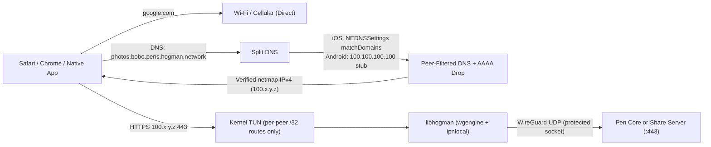

# Hogman Mobile Architecture (iOS & Android)

This document specifies how Hogman works on iOS and Android: how traffic is routed, how the shared Go engine stays within iOS's 50 MB Network Extension memory limit, how device keys and secrets are protected, and how users join and switch pens on a phone.

---

## Goals and Non-Goals

**Goals:**
- Join a Hogman pen on iOS or Android using the same invite (`#t=`) and personal device (`#k=`) links as desktop.
- Open pen sites (`https://home.bobo.pens.hogman.network`, `https://photos.bobo.pens.hogman.network`) in Safari, Chrome, Home Screen PWAs, and native mobile apps with standard public-CA HTTPS certificates and no custom root CA (D-18).
- Route **only** pen traffic through Hogman; normal internet browsing and carrier DNS never enter the tunnel.
- Share the exact enrollment, link-parsing, control-plane, and WireGuard/Tailscale logic with the desktop client (`core/join`) instead of reimplementing protocol logic in Swift and Kotlin.
- Keep the memory footprint safely under iOS's 50 MB `NEPacketTunnelProvider` limit.

**Non-goals:**
- **No `hogman share` on phones.** Mobile devices are personal client devices only; server links (`for=share`) are refused just as `hogman join` refuses them on desktop.
- **No full-device commercial VPN / exit-node mode.** Hogman never installs a default route (`0.0.0.0/0` or `::/0`).
- **No account recovery or device locking** (D-12, D-17). Leaving or uninstalling removes only that phone's device entry.
- **No third-party crash or analytics SDKs** (D-6).

---

## Why Mobile Uses Split-Tunnel VPN Instead of Desktop Side-by-Side Proxy

On macOS, Linux, and Windows, Hogman runs an unprivileged local HTTP CONNECT proxy (`127.0.0.1:<port>`) paired with the browser extension or a PAC file so it never occupies the OS VPN slot or asks for administrator rights (D-41).

Mobile browsers (Safari on iOS, Chrome on Android) do not support native-messaging browser extensions or persistent unprivileged localhost background proxies. To make every browser, Home Screen PWA, and native app reach `https://<site>.<pen>` seamlessly, Hogman Mobile uses the platform's standard user-consented split-tunnel VPN API:
- **Android:** `android.net.VpnService`
- **iOS:** `NEPacketTunnelProvider` (Network Extension)

**Explicit trade-offs:**
- iOS and Android allow only one active VPN tunnel at a time, so Hogman Mobile cannot run simultaneously with another VPN app (such as Mullvad or NordVPN) on the same phone.
- On Android, users must **not** enable Android's **"Block connections without VPN"** ("Always-on VPN" kill-switch) setting for Hogman: because Hogman routes only pen peers and tears down when disconnected, enabling that OS setting blocks all non-pen internet access. The app warns users if this mode is detected or when explaining VPN settings.

---

## Network Routing, Peer Scoping, and Split DNS



### 1. Per-Peer `/32` IPv4 Routes (Never Broad `100.64.0.0/10`)
Hogman's Headscale ACL policy (`core/registrar/internal/registrar/policy.go`) is intentionally IPv4-only and grants only:
- `tag:infra`: ports `53` (DNS) and `443` (Home portal)
- `tag:server` (shares): port `443` (HTTPS only, D-11)

Mobile must **not** claim all of `100.64.0.0/10` (RFC 6598): many cellular carriers assign phone interfaces or carrier DNS resolvers inside `100.64.0.0/10`, and routing the entire `/10` into the tunnel breaks cellular DNS (especially on iOS).

Instead, `libhogman` configures narrow `/32` routes via `reconfig_cb` whenever the Headscale netmap changes:
- Local interface address: `<self_ipv4>/32`
- Included routes:
  - One `/32` route per active `tag:infra` peer IPv4 and `tag:server` peer IPv4 in the pen's live netmap (other personal devices are unreachable under the ACL and are not routed).
  - On Android only: `100.100.100.100/32` for the local split-DNS stub.
- **Zero IPv6 routes and zero default route (`0.0.0.0/0` or `::/0`).**

Regular internet traffic and carrier CGNAT infrastructure never enter the TUN interface.

### 2. Enforcing "Dial Only Pen Devices" on Mobile DNS
On desktop, `agent.Dial` refuses to connect to any IP not present in the pen's Headscale netmap regardless of what DNS answers. On mobile, the OS dials whatever address DNS returns, so `libhogman` enforces the same invariant directly on DNS answers and TUN routing:
- For any `<zone>` lookup, **drop every `A` record whose IP is not an active peer in the pen's live Headscale netmap** (`mesh.StatusHasPeerIP`) and **drop every `AAAA` record** (IPv4-only policy).
- Because only active `tag:infra` and `tag:server` peer `/32` routes are installed on the TUN, a compromised registrar cannot redirect pen names to LAN hosts or public internet IPs through the tunnel.
- On Android, this filtering runs directly inside the `100.100.100.100` DNS forwarder. On iOS, `penDNSIPv4` queries cross `libhogman` over the TUN (or are handled by the same in-engine `<zone>` DNS proxy at a single `/32` stub address) so the exact same peer-filter and `AAAA`-drop logic applies on both platforms.

### 3. Platform-Specific Split DNS
- **iOS (`NEPacketTunnelNetworkSettings`):**
  iOS supports native domain-matched split DNS directly in `NEDNSSettings`:
  - `servers = [penDNSStubIPv4]` (peer-filtered DNS forwarded to the active `tag:infra` peer resolved via `mesh.ResolvePenDNSIP`, refusing member/server peers from impersonating pen DNS)
  - `matchDomains = [zone]` (e.g. `bobo.pens.hogman.network`)
  - `matchDomainsNoSearch = true`
  - Result: iOS sends **only** `*.<zone>` DNS queries into the extension; all other DNS queries go directly to Wi-Fi/cellular DNS without waking the extension.
- **Android (`VpnService.Builder`):**
  Android's `VpnService` does not provide per-domain `matchDomains`. Sending all queries to Registrar DNS would break general browsing because Registrar DNS refuses non-pen queries. Instead:
  - `VpnService.Builder` installs the per-peer `/32` routes plus `100.100.100.100/32` and sets `addDnsServer("100.100.100.100")`.
  - Inside `libhogman`, the local DNS forwarder at `100.100.100.100:53`:
    - Routes queries under `<zone>` over WireGuard to `penDNSIPv4:53`, applying the netmap peer filter and dropping `AAAA`.
    - Forwards all other queries to the phone's active network DNS servers (read via `ConnectivityManager.getLinkProperties(activeNetwork).dnsServers`) over sockets protected with `VpnService.protect(fd)` (`netns.SetAndroidProtectFunc`).
  - **Catch-all DNS forwarder invariants (required because all device DNS transits our process on Android):**
    1. **Data minimization:** Never log, count, persist, or cache beyond response TTL any non-pen domain names.
    2. **Fail-safe teardown:** If `libhogman` crashes or exits unexpectedly, `HogmanVpnService` must immediately close the TUN fd and call `stopSelf()` so Android drops `100.100.100.100` and normal device DNS recovers immediately.
    3. **Private DNS strict-mode detection:** When Android Private DNS is set to a fixed DoT hostname (`LinkProperties.isPrivateDnsActive()` with non-null `getPrivateDnsServerName()`), Android bypasses `VpnService` DNS servers and `*.<zone>` lookups will fail. The app detects this state and displays a clear notice instructing the user to set Private DNS to *Automatic* or *Off* while using Hogman.
    4. **Network handoff:** On Wi-Fi ↔ cellular changes or `LinkProperties` updates, `HogmanVpnService` calls `hogman_update_network(...)` with the refreshed upstream DNS list and nudges `netmon` so WireGuard rebinds promptly.
  - Because `libhogman` uses `VpnService.protect(fd)` rather than `addDisallowedApplication(packageName)`, outbound WireGuard, DERP, Headscale, and upstream DNS sockets bypass the VPN while in-app checks can still reach `https://home.<zone>` through the tunnel.

### 4. One Active Pen at a Time (Multiple Enrolled Pens)
Users can enroll multiple pens on one phone; each pen keeps its own isolated state directory (`<data_dir>/pens/<zone>/`) and WireGuard identity. Only **one pen tunnel is active at a time**, with a single-tap switcher in the app. This matches iOS's single-VPN-slot model and keeps memory usage predictable and well under 50 MB.

---

## iOS 50 MB Network Extension Memory Budget

iOS terminates `NEPacketTunnelProvider` extensions via Jetsam at **50 MB RSS**. Desktop `hogman` embeds full `tsnet` with gVisor's userspace TCP/IP stack (`netstack`), which is unnecessary when the OS already provides a real kernel TUN interface and pushes RSS too close to 50 MB.

Hogman Mobile avoids gVisor entirely:
1. **Direct kernel TUN:** Wire `tailscale.com/wgengine.NewUserspaceEngine` + `tailscale.com/ipn/ipnlocal.NewLocalBackend` directly onto the OS TUN file descriptor:
   - Android: `tun.CreateUnmonitoredTUNFromFD(tunFD)` from `VpnService.Builder.establish().detachFd()`
   - iOS: `tun.CreateTUNFromFile(os.NewFile(utunFD, "utun"), mtu)` from `NEPacketTunnelProvider`'s utun descriptor
2. **Compile-time feature stripping (`ts_omit_*`):** Build mobile artifacts with `-tags` omitting gVisor netstack (`ts_omit_netstack`) and unused desktop/server subsystems (`ts_omit_peerapiserver`, `ts_omit_peerapiclient`, `ts_omit_ssh`, `ts_omit_taildrop`, `ts_omit_drive`, `ts_omit_serve`, `ts_omit_webclient`, `ts_omit_webbrowser`, `ts_omit_capture`, `ts_omit_bird`, `ts_omit_aws`, `ts_omit_cloud`, `ts_omit_kube`, `ts_omit_tpm`, `ts_omit_dbus`, `ts_omit_iptables`, `ts_omit_networkmanager`, `ts_omit_resolved`, `ts_omit_sdnotify`, `ts_omit_synology`, `ts_omit_systray`, `ts_omit_syspolicy`, `ts_omit_wakeonlan`, `ts_omit_advertiseexitnode`, `ts_omit_advertiseroutes`, `ts_omit_useexitnode`, `ts_omit_useroutes`, `ts_omit_appconnectors`, `ts_omit_relayserver`, `ts_omit_tailnetlock`, `ts_omit_c2n`, `ts_omit_clientupdate`, `ts_omit_clientmetrics`, `ts_omit_logtail`, `ts_omit_netlog`, `ts_omit_portlist`, `ts_omit_posture`, `ts_omit_ace`, `ts_omit_acme`, `ts_omit_completion`, `ts_omit_completion_scripts`, `ts_omit_doctor`, `ts_omit_tap`, `ts_omit_desktop_sessions`, `ts_omit_flashappliance`, `ts_omit_identityfederation`, `ts_omit_oauthkey`, `ts_omit_outboundproxy`, `ts_omit_useproxy`, `ts_omit_remoteconfig`, `ts_omit_cliconndiag`, `ts_omit_qrcodes`, `ts_omit_gro`, `ts_omit_debug`, `ts_omit_debugportmapper`, `ts_omit_debugeventbus`).
3. **Go GC tuning:** Inside the mobile tunnel entrypoint, set `debug.SetMemoryLimit(28 << 20)` (28 MiB soft cap) and `debug.SetGCPercent(25)` on iOS so garbage collection stays ahead of Jetsam.
4. **Verification gate:** Measure steady-state and active HTTPS transfer RSS on Android Emulator and macOS/iOS harnesses during Stage 2 before moving to App Store packaging, targeting **≤ 25 MB steady-state RSS**.

---

## Shared Go Core and Native Bridge (`core/join/mobile`)

### Repository Layout
```text
core/join/
  internal/{link,penapi,mesh,state,...}   # Existing shared protocol & state packages
  mobile/                                 # Shared Go mobile engine + C-ABI exports (no separate go.mod)
mobile/
  android/                                # Kotlin + Jetpack Compose + VpnService + JNI C shim
  ios/                                    # SwiftUI + NEPacketTunnelProvider + HogmanCore.xcframework
docs/mobile.md                            # This specification
```

Placing the Go mobile package at `core/join/mobile/` lets it import `hogman/join/internal/{link,penapi,mesh,state}` directly with a single `go.mod` and a single pinned `tailscale.com` version — zero duplicate link parsing, invite redemption, or peer-status logic.

### Why C-ABI (`c-shared` / `c-archive`) Instead of `gomobile`
The boundary between Swift/Kotlin and Go is small (9 coarse-grained JSON/callback calls). Using Go's built-in `-buildmode=c-shared` (Android) and `-buildmode=c-archive` (iOS):
- Requires no `golang.org/x/mobile` code generator (which routinely lags new Go releases).
- Passes all `ts_omit_*` build tags cleanly and deterministically in CI.
- Links cleanly with `-Wl,-z,max-page-size=16384` under Android NDK 28 to satisfy Google Play's 16 KB ELF page-alignment requirement (API 35+).
- Bridges into Swift natively via a C header + `module.modulemap` inside `HogmanCore.xcframework`, and into Kotlin via a small JNI C shim (`hogman_jni.c`).

### C-ABI Safety Rules
- **Hard input size caps, reject — never truncate (D-56):** Every C-ABI string parameter enforces an explicit byte limit (e.g., 4 KiB for join links, 256 B for zone/handle/hostname, 16 KiB for DNS JSON, 64 KiB for debug-only CA PEM) and returns a structured `{"ok":false,"error":"..."}` error if exceeded rather than truncating.
- **No secret leakage in error strings or crash dumps:** Join links, `#t=` tokens, `#k=` keys, and `state_key` values are never included in returned errors, logs, or panic traces.
- **JNI thread attachment:** Callbacks invoked from Go goroutines (`protect_cb`, `reconfig_cb`) must attach the calling OS thread to the JVM (`AttachCurrentThread`) and detach cleanly in `hogman_jni.c`.
- **Fuzzing:** Fuzz JSON input parsing and C-ABI round-trips in `core/join/mobile` unit tests.
- **`control_ca_pem` restricted to debug/staging builds:** Release builds compile out/ignore custom CA PEMs (trusting only OS system roots) and never accept CA material from links or user paste.

### Native Bridge Contract

All string returns are heap-allocated UTF-8 JSON (`{"ok":true,...}` or `{"ok":false,"error":"..."}`) freed by the caller with `hogman_free(ptr)`:

| Function | Purpose |
|---|---|
| `hogman_parse_link(raw_link)` | Validates `#t=` / `#k=` link using `internal/link`; rejects `for=share` server links; returns `{host, kind, for_share}`. |
| `hogman_join(data_dir, state_key, state_key_len, raw_link, handle, device_name, control_ca_pem)` | Validates `state_key_len == 32` (`const uint8_t*`, copied into a mutable `[]byte` and zeroed on return), fetches `/hogman/v1/network`, redeems `#t=` invite (or validates `#k=`), persists `<data_dir>/pens/<zone>/pen.json` + AEAD-encrypted one-time `authkey.enc`, returns pen metadata (`zone`, `portal`, `handle`, `hostname`). `control_ca_pem` is rejected/ignored in release builds. |
| `hogman_list_pens(data_dir)` | Lists enrolled pens (`zone`, `portal`, `hostname`, `dns_server`). |
| `hogman_start_tunnel(data_dir, state_key, state_key_len, zone, mtu, upstream_dns_json, protect_cb, reconfig_cb, user_data)` | Validates `state_key_len == 32`, starts `wgengine` + `ipnlocal` backed by the AEAD-encrypted `ipn.StateStore` on `SwappableTUN`, registers `protect_cb` (Android `VpnService.protect`), deletes `authkey.enc` once enrolled, resolves `tag:infra` DNS IP, and invokes `reconfig_cb` with `{self_ipv4, dns_ip, dns_stub_ip, zone, mtu, peer_routes}` (`reconfig_cb` returns a new TUN fd `>= 0`, `-1` to keep existing TUN, or `-2` on fatal OS VPN error). |
| `hogman_update_network(upstream_dns_json, link_changed)` | Refreshes Android split-DNS upstream resolvers and triggers `netmon` / WireGuard rebind on Wi-Fi ↔ cellular switches. |
| `hogman_status()` | Returns `{state, zone, portal, self_ipv4, dns_ip, peer_routes, needs_login, error}`. |
| `hogman_stop_tunnel()` | Gracefully shuts down the active tunnel engine, releases resources, and zeroes the in-memory DEK `[]byte`. |
| `hogman_leave(data_dir, state_key, state_key_len, zone, force)` | Calls self-delete over the active tunnel when reachable (enforcing sole-owner safety unless `force`), stops the tunnel if active for `zone`, and deletes `<data_dir>/pens/<zone>`. UI must require typing the exact pen name before passing `force=true` (matching D-39). |
| `hogman_free(ptr)` | Frees a C string returned by any `hogman_*` call. |

---

## Security and Device-Key Protection

### 1. Non-Cloneable Device Keys (Preventing Backup & Phone-to-Phone Transfer)
A cloned WireGuard/Tailscale node private key gives two phones the same device identity; revoking one silently revokes the other. Hogman Mobile prevents cloning across both backups and device-to-device migrations:

- **Encrypted `ipn.StateStore` in `core/join/mobile`:** The Tailscale node state (containing the WireGuard/node private key) and pending one-time `authkey` are encrypted at rest with AES-256-GCM using a per-device 32-byte data-encryption key (DEK) supplied by the platform at startup and zeroed on teardown.
- **iOS:**
  - The 32-byte DEK is stored exclusively in the **iOS Keychain** with `kSecAttrAccessibleAfterFirstUnlockThisDeviceOnly` inside a Keychain Access Group shared between the main app and the `NEPacketTunnelProvider` extension.
  - `ThisDeviceOnly` guarantees the key is excluded from iCloud Backup, Finder/iTunes backups, **and** iPhone-to-iPhone Quick Start migration, while still permitting locked-screen VPN reconnects after first unlock.
  - Non-key pen metadata and ciphertext state files in the shared App Group container (`group.network.hogman.mobile`) also set `NSFileProtectionCompleteUntilFirstUserAuthentication` and `NSURLIsExcludedFromBackupKey = true`.
- **Android:**
  - Generate the 32-byte DEK once, wrap it with a **non-exportable Android Keystore** AES-GCM `SecretKey` (hardware-backed / StrongBox when available), and store the wrapped DEK and ciphertext pen state in `context.noBackupFilesDir` (`0700`).
  - Set `android:allowBackup="false"` **and** provide `res/xml/data_extraction_rules.xml` explicitly excluding all pen state from **both** `<cloud-backup>` and `<device-transfer>` (required on Android 12+ where `allowBackup="false"` alone does not block device-to-device cable/cloud transfers).

### 2. Fragments, Logging, and Crash Reports
- **Fragments never leave the device:** Invite tokens (`#t=`) and device keys (`#k=`) stay strictly in the URL fragment, never in query parameters, server logs, crash reports, or OS logs.
- **No custom URL scheme for secrets:** Custom URL schemes (`hogman://...`) are unverified and can be claimed by any installed app on iOS or Android. Secrets (`#t=`, `#k=`) are **never** carried over a custom URL scheme — only via verified Universal Links / App Links, QR scan, or explicit Paste. If a custom scheme is ever added later (e.g. `hogman://open`), it must never accept or carry `#t=`/`#k=`.
- **No telemetry or stray logs:** `core/join/mobile` calls `envknob.SetNoLogsNoSupport()` at init (matching desktop `nologs.go`), suppresses `Logf`/`UserLogf` by default, and ships **zero** third-party crash or analytics SDKs (D-6). Join links and tokens are kept out of error strings and stack frames so OS crash logs never capture them.
- **One-time `authkey` cleanup:** Just like desktop, the encrypted pending `authkey` is deleted immediately once Headscale enrollment succeeds (`Up` completes).
- **No background clipboard snooping:** The app never reads the system clipboard automatically; pasting a link requires an explicit user tap on **Paste**.
- **Removal / revocation handling:** If Headscale returns `NeedsLogin` after enrollment (`mesh.ErrDeviceRemoved`), the tunnel stops cleanly and marks the pen as removed so the user sees a clear "This device was removed from `<pen>`" state rather than retrying forever.

---

## Phone-First Onboarding UX

Nobody copies a shell command on a phone. Mobile supports these join paths using the exact same links as desktop:

1. **Scan QR code (primary laptop → phone flow):**
   - `home.<pen>` renders client-side QR codes using a **vendored** QR library (no CDN `<script>`, preserving the portal's existing CSP) for **Add another device** (`#k=`, displaying a clear "valid for 1 hour, single use" note beside the code) and **Invite someone** (`#t=`).
   - Scanning in the Hogman app parses the link locally, prompts for a handle if `#t=` (validating `link.HandleRE` and handling `409` handle-taken retries cleanly), joins, and prompts once for the OS VPN permission.
2. **Paste join link:** Explicit **Paste** button in the app for links received over Signal/iMessage/email.
3. **Verified Universal Links / App Links (post-store launch only):**
   - Until Apple Developer and Google Play Organization accounts exist and publish `apple-app-site-association` (AASA) and `assetlinks.json` (`autoVerify`), `/join` on mobile must **not** render a custom-scheme "Open in Hogman" button; instead it instructs the user to scan the QR code or paste the link inside the Hogman app.
   - Once store accounts are active, verified Universal Links / App Links can open `https://<pen>/join#...` directly in the Hogman app with OS-verified domain ownership.

**Main screen:**
- Active pen status card (Disconnected / Connecting / Connected with green indicator), one-tap **Connect / Disconnect** toggle, and one-tap **Open Home** button (opens `https://home.<pen>` in the system browser).
- Enrolled pens list (switch active pen with one tap, **Join a pen**, **Leave pen** with confirmation — requiring the user to type the exact pen name before overriding the sole-owner guard, matching D-39).

---

## Build and Delivery Stages

1. **Stage 1 — Architecture spec (this document):** Align on routing, per-peer `/32` scoping, non-cloneable device keys, memory budget, C-ABI boundary, and security invariants.
2. **Stage 2 — Shared Go mobile core (`core/join/mobile`):**
   - Implement the 9-function C-ABI engine over `wgengine` + `ipnlocal` + AES-256-GCM `ipn.StateStore` + peer-filtered split-DNS forwarder.
   - Unit and fuzz tests for link parsing, C-ABI size caps (reject, never truncate), encrypted `StateStore`, peer-filtered DNS (`A` peer check + `AAAA` drop), `NeedsLogin` handling, and JSON round-trips.
   - Cross-compile `libhogman.so` (`android/arm64`, `android/amd64` with 16 KB ELF alignment) and `HogmanCore.xcframework` (`ios/arm64`, `ios-simulator`), and benchmark RSS against the 50 MB iOS ceiling.
3. **Stage 3 — Android app (`mobile/android`):**
   - Kotlin + Jetpack Compose UI, `HogmanVpnService` (per-peer `/32` routes, fail-safe teardown on engine exit, Private DNS strict-mode notice), Keystore-wrapped DEK + `noBackupFilesDir` + `<cloud-backup>`/`<device-transfer>` exclusion rules, `ConnectivityManager` callback, QR scanner, and JNI shim with proper thread attachment.
   - End-to-end verification on Android Emulator + Chrome against staging: join, split-tunnel HTTPS padlock on `home` + a shared site, general internet browsing unaffected, Private DNS strict-mode detection, network change resilience, and clean leave.
4. **Stage 4 — iOS app (`mobile/ios`):**
   - SwiftUI app + `NEPacketTunnelProvider` extension target linked against `HogmanCore.xcframework`, Keychain DEK (`AfterFirstUnlockThisDeviceOnly` in shared Keychain Access Group), App Group backup exclusion.
   - Build & verify all non-NE flows (join, pen list, Keychain/App Group storage, QR, leave) on iOS Simulator immediately; enable `com.apple.developer.networking.networkextension`, test on a physical iPhone, and ship to TestFlight as soon as the Apple Developer Organization account is active.
5. **Stage 5 — Mobile onboarding polish on `/join` and `home.<pen>`:**
   - Vendored client-side QR code modal on `home.<pen>` (`Add another device` with 1-hour/single-use note & `Invite someone`), and mobile `/join` copy (plus verified Universal Links / App Links once store accounts publish AASA and `assetlinks.json`).
