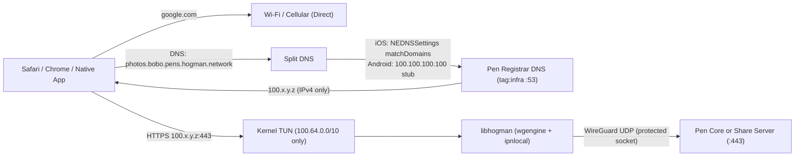

# Hogman Mobile Architecture (iOS & Android)

This document specifies how Hogman works on iOS and Android: how traffic is routed, how the shared Go engine stays within iOS's 50 MB Network Extension memory limit, how secrets are stored, and how users join and switch pens on a phone.

---

## Goals and Non-Goals

**Goals:**
- Join a Hogman pen on iOS or Android using the same invite (`#t=`) and personal device (`#k=`) links as desktop.
- Open pen sites (`https://home.bobo.pens.hogman.network`, `https://photos.bobo.pens.hogman.network`) in Safari, Chrome, Home Screen PWAs, and native mobile apps with standard public-CA HTTPS certificates and no custom root CA (D-18).
- Route **only** pen traffic through Hogman; normal internet browsing never enters the tunnel.
- Share the exact enrollment, link-parsing, control-plane, and WireGuard/Tailscale logic with the desktop client (`core/join`) instead of reimplementing protocol logic in Swift and Kotlin.
- Keep the memory footprint safely under iOS's 50 MB `NEPacketTunnelProvider` limit.

**Non-goals:**
- **No `hogman share` on phones.** Mobile devices are personal client devices only; server links (`for=share`) are refused just as `hogman join` refuses them on desktop.
- **No full-device commercial VPN / exit-node mode.** Hogman never installs a default route (`0.0.0.0/0` or `::/0`).
- **No account recovery or device locking** (D-12, D-17). Leaving or uninstalling removes only that phone's device entry.

---

## Why Mobile Uses Split-Tunnel VPN Instead of Desktop Side-by-Side Proxy

On macOS, Linux, and Windows, Hogman runs an unprivileged local HTTP CONNECT proxy (`127.0.0.1:<port>`) paired with the browser extension or a PAC file so it never occupies the OS VPN slot or asks for administrator rights (D-41).

Mobile browsers (Safari on iOS, Chrome on Android) do not support native-messaging browser extensions or persistent unprivileged localhost background proxies. To make every browser, Home Screen PWA, and native app reach `https://<site>.<pen>` seamlessly, Hogman Mobile uses the platform's standard user-consented split-tunnel VPN API:
- **Android:** `android.net.VpnService`
- **iOS:** `NEPacketTunnelProvider` (Network Extension)

**Explicit trade-off:** iOS and Android allow only one active VPN tunnel at a time, so Hogman Mobile cannot run simultaneously with another VPN app (such as Mullvad or NordVPN) on the same phone.

---

## Network Routing and Split DNS



### 1. IPv4-Only Mesh Routes (`100.64.0.0/10`)
Hogman's Headscale ACL policy (`core/registrar/internal/registrar/policy.go`) is intentionally IPv4-only (`100.64.0.0/10`, with IPv6 default-denied) and grants only:
- `tag:infra`: ports `53` (DNS) and `443` (Home portal)
- `tag:server` (shares): port `443` (HTTPS only, D-11)

Mobile configures the TUN interface with:
- Local interface address: `<self_ipv4>/32`
- Included route: **`100.64.0.0/10` only** (no IPv6 routes, no default route `0.0.0.0/0`).

No regular internet IPv4 or IPv6 packets ever enter the TUN interface.

### 2. Platform-Specific Split DNS
- **iOS (`NEPacketTunnelNetworkSettings`):**
  iOS supports native domain-matched split DNS directly in `NEDNSSettings`:
  - `servers = [penDNSIPv4]` (resolved from an active `tag:infra` peer via `mesh.ResolvePenDNSIP`, refusing member/server peers from impersonating pen DNS)
  - `matchDomains = [zone]` (e.g. `bobo.pens.hogman.network`)
  - `matchDomainsNoSearch = true`
  - Result: iOS routes **only** `*.<zone>` DNS lookups into the tunnel; all other DNS queries go directly to Wi-Fi/cellular DNS and never wake the extension.
- **Android (`VpnService.Builder`):**
  Android's `VpnService` does not provide per-domain `matchDomains`. Sending all queries to Registrar DNS would break general internet browsing because Registrar DNS refuses non-pen queries.
  Instead:
  - `VpnService.Builder` sets `addRoute("100.64.0.0", 10)` and `addDnsServer("100.100.100.100")`.
  - Inside `libhogman`, Tailscale's built-in DNS forwarder intercepts `100.100.100.100:53`:
    - Queries under `<zone>` forward over WireGuard to `penDNSIPv4:53`.
    - All other queries forward to the phone's active network DNS servers (read via `ConnectivityManager.getLinkProperties(activeNetwork).dnsServers`), using sockets protected with `VpnService.protect(fd)` via `netns.SetAndroidProtectFunc`.
  - When Android switches networks (Wi-Fi ↔ cellular) or `LinkProperties` changes, the Android service calls `hogman_update_network(...)` with the refreshed upstream DNS list and notifies `netmon` so WireGuard rebinds immediately.
  - Because `libhogman` uses `VpnService.protect(fd)` rather than `addDisallowedApplication(packageName)`, outbound WireGuard, DERP, Headscale, and upstream DNS sockets bypass the VPN while in-app checks can still reach `https://home.<zone>` through the tunnel.

### 3. One Active Pen at a Time (Multiple Enrolled Pens)
Users can enroll multiple pens on one phone; each pen keeps its own isolated state directory (`<data_dir>/pens/<zone>/`) and WireGuard identity. Only **one pen tunnel is active at a time**, with a single-tap switcher in the app. This matches iOS's single-VPN-slot model and keeps memory usage predictable and well under 50 MB.

---

## iOS 50 MB Network Extension Memory Budget

iOS terminates `NEPacketTunnelProvider` extensions via Jetsam at **50 MB RSS**. Desktop `hogman` embeds full `tsnet` with gVisor's userspace TCP/IP stack (`netstack`), which is unnecessary when the OS already provides a real kernel TUN interface and pushes RSS too close to 50 MB.

Hogman Mobile avoids gVisor entirely:
1. **Direct kernel TUN:** Wire `tailscale.com/wgengine.NewUserspaceEngine` + `tailscale.com/ipn/ipnlocal.NewLocalBackend` directly onto the OS TUN file descriptor:
   - Android: `tun.CreateUnmonitoredTUNFromFD(tunFD)` from `VpnService.Builder.establish().detachFd()`
   - iOS: `tun.CreateTUNFromFile(os.NewFile(utunFD, "utun"), mtu)` from `NEPacketTunnelProvider`'s utun descriptor
2. **Compile-time feature stripping (`ts_omit_*`):** Build mobile artifacts with `-tags` omitting gVisor netstack (`ts_omit_netstack`) and unused desktop/server subsystems (`ts_omit_peerapiserver`, `ts_omit_peerapiclient`, `ts_omit_ssh`, `ts_omit_taildrop`, `ts_omit_drive`, `ts_omit_serve`, `ts_omit_webclient`, `ts_omit_webbrowser`, `ts_omit_capture`, `ts_omit_bird`, `ts_omit_aws`, `ts_omit_cloud`, `ts_omit_kube`, `ts_omit_tpm`, `ts_omit_dbus`, `ts_omit_iptables`, `ts_omit_networkmanager`, `ts_omit_resolved`, `ts_omit_sdnotify`, `ts_omit_synology`, `ts_omit_systray`, `ts_omit_syspolicy`, `ts_omit_wakeonlan`, `ts_omit_advertiseexitnode`, `ts_omit_advertiseroutes`, `ts_omit_useexitnode`, `ts_omit_useroutes`, `ts_omit_appconnectors`, `ts_omit_relayserver`, `ts_omit_tailnetlock`, `ts_omit_c2n`, `ts_omit_clientupdate`, `ts_omit_clientmetrics`, `ts_omit_logtail`, `ts_omit_netlog`, `ts_omit_portlist`, `ts_omit_posture`, `ts_omit_ace`, `ts_omit_acme`, `ts_omit_completion`, `ts_omit_completion_scripts`, `ts_omit_doctor`, `ts_omit_tap`, `ts_omit_desktop_sessions`, `ts_omit_flashappliance`, `ts_omit_identityfederation`, `ts_omit_oauthkey`, `ts_omit_outboundproxy`, `ts_omit_useproxy`, `ts_omit_remoteconfig`, `ts_omit_cliconndiag`, `ts_omit_qrcodes`, `ts_omit_gro`, `ts_omit_debug`, `ts_omit_debugportmapper`, `ts_omit_debugeventbus`).
3. **Go GC tuning:** Inside the mobile tunnel entrypoint, set `debug.SetMemoryLimit(28 << 20)` (28 MiB soft cap) and `debug.SetGCPercent(25)` on iOS so garbage collection stays ahead of Jetsam.
4. **Verification gate:** Measure steady-state and active HTTPS transfer RSS on Android Emulator and macOS/iOS harnesses during Stage 2 before moving to App Store packaging, targeting **≤ 25 MB steady-state RSS**.

---

## Shared Go Core and Native Bridge (`core/join/mobile`)

### Repository Layout
```text
core/join/
  internal/{link,penapi,mesh,state,...}   # Existing shared protocol & state packages
  mobile/                                 # Shared Go mobile engine + C-ABI exports (no separate go.mod)
mobile/
  android/                                # Kotlin + Jetpack Compose + VpnService + JNI C shim
  ios/                                    # SwiftUI + NEPacketTunnelProvider + HogmanCore.xcframework
docs/mobile.md                            # This specification
```

Placing the Go mobile package at `core/join/mobile/` lets it import `hogman/join/internal/{link,penapi,mesh,state}` directly with a single `go.mod` and a single pinned `tailscale.com` version — zero duplicate link parsing, invite redemption, or peer-status logic.

### Why C-ABI (`c-shared` / `c-archive`) Instead of `gomobile`
The boundary between Swift/Kotlin and Go is small (9 coarse-grained JSON/callback calls). Using Go's built-in `-buildmode=c-shared` (Android) and `-buildmode=c-archive` (iOS):
- Requires no `golang.org/x/mobile` code generator (which routinely lags new Go releases).
- Passes all `ts_omit_*` build tags cleanly and deterministically in CI.
- Links cleanly with `-Wl,-z,max-page-size=16384` under Android NDK 28 to satisfy Google Play's 16 KB ELF page-alignment requirement (API 35+).
- Bridges into Swift natively via a C header + `module.modulemap` inside `HogmanCore.xcframework`, and into Kotlin via a small (~80-line) JNI C shim (`hogman_jni.c`).

### Native Bridge Contract

All string returns are heap-allocated UTF-8 JSON (`{"ok":true,...}` or `{"ok":false,"error":"..."}`) freed by the caller with `hogman_free(ptr)`:

| Function | Purpose |
|---|---|
| `hogman_parse_link(raw_link)` | Validates `#t=` / `#k=` link using `internal/link`; rejects `for=share` server links; returns `{host, kind, for_share}`. |
| `hogman_join(data_dir, raw_link, handle, device_name, control_ca_pem)` | Fetches `/hogman/v1/network`, redeems `#t=` invite (or validates `#k=`), persists `<data_dir>/pens/<zone>/config.json` + one-time `authkey` (`0600`), returns pen metadata (`zone`, `portal`, `handle`, `hostname`). |
| `hogman_list_pens(data_dir)` | Lists enrolled pens (`zone`, `portal`, `hostname`, `dns_server`). |
| `hogman_start_tunnel(data_dir, zone, tun_fd, mtu, upstream_dns_json, protect_cb, reconfig_cb)` | Starts `wgengine` + `ipnlocal` on `tun_fd`, registers `protect_cb` (Android `VpnService.protect`), deletes one-time `authkey` once enrolled, resolves `tag:infra` DNS IP, and invokes `reconfig_cb` with `{self_ipv4, dns_ip, zone, mtu}` whenever IP or DNS peer changes. |
| `hogman_update_network(upstream_dns_json, link_changed)` | Refreshes Android split-DNS upstream resolvers and triggers `netmon` / WireGuard rebind on Wi-Fi ↔ cellular switches. |
| `hogman_status()` | Returns `{state, zone, portal, self_ipv4, dns_ip, needs_login, error}`. |
| `hogman_stop_tunnel()` | Gracefully shuts down the active tunnel engine and releases resources. |
| `hogman_leave(data_dir, zone, force)` | Calls self-delete when reachable (enforcing sole-owner safety unless `force`), stops the tunnel if active for `zone`, and deletes `<data_dir>/pens/<zone>`. |
| `hogman_free(ptr)` | Frees a C string returned by any `hogman_*` call. |

---

## Security and Secret Handling

- **Fragments never leave the device:** Invite tokens (`#t=`) and device keys (`#k=`) stay strictly in the URL fragment, never in query parameters, server logs, crash logs, or OS logs.
- **No Tailscale telemetry or stray logs:** `core/join/mobile` calls `envknob.SetNoLogsNoSupport()` at init (matching desktop `nologs.go`) and suppresses `Logf`/`UserLogf` by default. Secrets are never written to `logcat` or `os_log`.
- **One-time `authkey` cleanup:** Just like desktop, the one-time enrollment key file is removed immediately once Headscale enrollment succeeds (`Up` completes).
- **At-rest protection and backup exclusion:**
  - **Android:** Store pen state inside `context.filesDir` (`0700`, encrypted at rest by Android file-based encryption), set `android:allowBackup="false"`, and exclude state in `data_extraction_rules.xml` so device keys are never synced to Google Drive Backup.
  - **iOS:** Store pen state inside the shared App Group container (`group.network.hogman.mobile`) with `NSFileProtectionCompleteUntilFirstUserAuthentication` (allowing background reconnect while the screen is locked after first unlock) and `NSURLIsExcludedFromBackupKey = true` (excluded from iCloud and iTunes backups).
- **No background clipboard snooping:** The app never reads the system clipboard automatically; pasting a link requires an explicit user tap on **Paste**.
- **Removal / revocation handling:** If Headscale returns `NeedsLogin` after enrollment (`mesh.ErrDeviceRemoved`), the tunnel stops cleanly and marks the pen as removed so the user sees a clear "This device was removed from `<pen>`" state rather than retrying forever.

---

## Phone-First Onboarding UX

Nobody copies a shell command on a phone. Mobile supports three join paths using the exact same links:

1. **Scan QR code (primary laptop → phone flow):**
   - `home.<pen>` renders client-side QR codes (generated in browser JS, never sent to any server) for **Add another device** (`#k=`) and **Invite someone** (`#t=`).
   - Scanning in the Hogman app parses the link locally, prompts for a handle if `#t=` (validating `link.HandleRE` and handling `409` handle-taken retries cleanly), joins, and prompts once for the OS VPN permission.
2. **Paste join link:** Explicit Paste button in the app for links received over Signal/iMessage/email.
3. **Tap join link on phone:**
   - Opening `https://<pen>/join#t=...` or `#k=...` in Safari/Chrome on a phone displays an **Open in Hogman** button using `hogman://join#...` (keeping the secret strictly in the fragment) and a store link when the app is not installed.
   - Once Apple Developer and Google Play Organization accounts are active, Universal Links (`apple-app-site-association`) and Android App Links (`assetlinks.json`) can optionally hand `/join` straight to the app.

**Main screen:**
- Active pen status card (Disconnected / Connecting / Connected with green indicator), one-tap **Connect / Disconnect** toggle, and one-tap **Open Home** button (opens `https://home.<pen>` in the system browser).
- Enrolled pens list (switch active pen with one tap, **Join a pen**, **Leave pen** with confirmation).

---

## Build and Delivery Stages

1. **Stage 1 — Architecture spec (this document):** Align on routing, memory budget, C-ABI boundary, and security invariants.
2. **Stage 2 — Shared Go mobile core (`core/join/mobile`):**
   - Implement the 9-function C-ABI engine over `wgengine` + `ipnlocal` + split-DNS stub.
   - Unit tests for link parsing, join/leave, split-DNS routing, `NeedsLogin` handling, and C-ABI JSON round-trips.
   - Cross-compile `libhogman.so` (`android/arm64`, `android/amd64` with 16 KB ELF alignment) and `HogmanCore.xcframework` (`ios/arm64`, `ios-simulator`), and benchmark RSS against the 50 MB iOS ceiling.
3. **Stage 3 — Android app (`mobile/android`):**
   - Kotlin + Jetpack Compose UI, `HogmanVpnService`, `ConnectivityManager` network/DNS callback, QR scanner, and JNI shim.
   - End-to-end verification on Android Emulator + Chrome against staging: join, split-tunnel HTTPS padlock on `home` + a shared site, general internet browsing unaffected, Wi-Fi/network change resilience, and clean leave.
4. **Stage 4 — iOS app (`mobile/ios`):**
   - SwiftUI app + `NEPacketTunnelProvider` extension target linked against `HogmanCore.xcframework`.
   - Build & verify all non-NE flows (join, pen list, Keychain/App Group storage, QR, leave) on iOS Simulator immediately; enable `com.apple.developer.networking.networkextension`, test on a physical iPhone, and ship to TestFlight as soon as the Apple Developer Organization account is active.
5. **Stage 5 — Mobile onboarding polish on `/join` and `home.<pen>`:**
   - Client-side QR code modal on `home.<pen>` (`Add another device` & `Invite someone`) and mobile **Open in Hogman** CTA on `/join`.
